# sre-agent

[](https://github.com/KakoozaJerry/sre-agent/actions/workflows/ci.yml) [](https://github.com/KakoozaJerry/sre-agent/releases) [](LICENSE) [](https://www.python.org/downloads/)

**The SRE agent you can audit.**

No API key, and no model required: every claim cites its evidence, and every release ships its scores.

An autonomous SRE agent that detects production incidents, works out what is wrong using real evidence, and helps fix them — without ever being allowed to make things worse on its own.

Built in the open by [Abraham Kakooza](https://github.com/KakoozaJerry).

**v0.2.0 · chaos 5 of 5 · regression PASS · injection 8 of 8 · Tier 3 drills 7 of 7 · security probes 10 of 10 · 0 unsafe actions** — full scores in [docs/evaluation.md](docs/evaluation.md).

[Quick start](#quick-start) · [Try the hosted demo](#try-the-hosted-demo) · [Evaluation](docs/evaluation.md) · [Progress log](docs/progress.md)

| Capability | What it does today |
|---|---|
| Alert ingestion | Alertmanager and generic webhooks; duplicates counted, related alerts grouped, resolved alerts close the incident; ingestion caps on |
| Evidence-cited diagnosis | The server runs the reasoning loop at ingestion; every claim cites evidence and the exact query behind it, or the incident escalates to a human |
| Fixes with approval | Three runbooks only (restart, scale, rollback); Tier 2 needs a named human (single-use, 15-minute expiry, policy re-checked); no free-form commands, ever |
| Bounded autonomy | Tier 3 demo grant only: restart and scale in the demo shop namespace, at most three replicas; rollback is never pre-approved |
| Safety record | Every policy decision is audit-logged before anything runs; the audit file is hash-chained and tamper-evident |
| Memory advice | Past-incident advice attached after a diagnosis is decided — advice only; it runs nothing and approves nothing |
| Read adapters | Kubernetes pods, Datadog metrics and Azure Monitor KQL as extra evidence, as counts and measured values only |
| Model backend | A language-model backend behind the same report shape, off by default; scores published separately per backend (see below) |
| Hosted demo | Public demo on seeded data only, token required, Tier 3 grant the only runnable action |

## Watch it: one alert in about a minute



A 74-second terminal recording of the walkthrough below, made from a real run of the shipped server (alert, diagnosis, approve, resolved) — output lines are shortened for the screen, and the values shown are the real replies, checked by the script that made it, [demo/make_walkthrough_recording.py](demo/make_walkthrough_recording.py). The pauses are reading pauses, not the agent's speed. Play the full recording with `asciinema play demo/walkthrough.cast` (the file is [demo/walkthrough.cast](demo/walkthrough.cast)).

## In plain English

When a production system breaks, an on-call engineer gets paged, opens five different tools, pieces together what happened, tries a fix, and checks it worked. Most of the time goes on figuring out what is wrong, not on the fix itself.

`sre-agent` does the figuring-out part automatically:

1. An alert arrives (from Prometheus/Alertmanager, or a generic webhook).
2. The agent gathers evidence — metrics, logs, the state of the service, what changed recently.
3. It writes a diagnosis where **every claim points at the evidence behind it**.
4. If a known fix applies, it proposes the exact action. A human approves it with one command. Only then does anything change.
5. Afterwards it drafts the postmortem from its own records.

The agent is never given free rein. It cannot run arbitrary commands, it can only use a small list of pre-approved fixes ("runbooks"), and every action — proposed, approved, or rejected — is written to an audit log before anything runs.

## Status

**Current version:** 0.2.0. Phases 0–10 are complete; Phase 11 (presentation and distribution) is in progress.
**What works today:** alert ingestion, evidence-cited diagnosis in the server, human-approved fixes, the Tier 3 demo grant, memory advice, read adapters, a database store, and a live hosted demo.
**Top scores (v0.2.0, deterministic backend):** chaos 5 of 5, regression PASS, injection 8 of 8, Tier 3 drills 7 of 7, security probes 10 of 10, 0 unsafe actions.
**One honest limit:** it does not manage real production systems yet — it is proven on seeded demo data, and the live adapters are untested against real systems.
The full history lives in [docs/progress.md](docs/progress.md) and [CHANGELOG.md](CHANGELOG.md); this section stays short on purpose.

## Try the hosted demo

The agent runs in public at **https://sre-agent-demo.onrender.com** — no install, nothing to set up. Every API route needs the visitor token, sent in the `X-SRE-Agent-Token` header: `sre-agent-demo-visitor`. (The landing page at the address itself and `/health` are open — they serve no data.) The token is public on purpose — [docs/hosted-demo.md](docs/hosted-demo.md) explains why that is safe here.

A visitor can: check `/health`; send the demo alert and read the evidence-cited diagnosis; watch the Tier 3 demo restart run (restart and scale, shop namespace only, at most three replicas); and close the incident with a resolved alert. What it cannot do is stated just as plainly: the data is seeded demo data, nothing real is touched, and rollback can never run there — it needs a human, and the hosted mode has no approval path at all. One free-plan limit: the service sleeps after about 15 minutes idle, so the first request can take a minute to wake it.

## Why build this in the open?

Reliability is the whole point of SRE, and the best proof of reliability is a public record. This repository is that record: a public plan, a public progress log, published test and evaluation scores with every release, and honest postmortems when the project itself breaks. If this agent claims it can be trusted, you can check.

## What it cannot do yet

Being straight about this matters more than hype:

- It does not manage real production systems yet. It is being proven in a local demo environment where failures are injected on purpose.
- Diagnosis is read-only first. Fixing things (with human approval) comes after the diagnosis is measurably good.
- Diagnosis does not need a language model: the default backend is plain rules that anyone can run with no API key. A language-model backend exists behind the same report shape, off by default, and this repository ships no real model client — an operator who wants one supplies their own client, provider and key in code. Its scores are published separately per backend in [docs/evaluation.md](docs/evaluation.md), and no real model has been scored, so no real model is recommended. A model may also propose a fix through a separate channel, under the same policy, tiers and audit log as any other proposal — a model can propose, never approve.

## Documents

Start with the map, then use the full list below it. Each
document has one job, so a reader does not have to guess
where a fact lives.

| You want to | Read | Its job |
|---|---|---|
| Get the pitch and start | This README | Pitch and start: what it is, the quickstart, and one alert end to end |
| Run it day to day | [docs/operator-guide.md](docs/operator-guide.md) | Run it: install, server, approvals, stopping it, troubleshooting |
| See the scores | [docs/evaluation.md](docs/evaluation.md) | Scores: the scenarios, the per-backend scores, and what is not scored |
| Check the safety case | [docs/security-review.md](docs/security-review.md) | Safety: what was attacked, what held, and the findings that remain |
| Follow what changed | [docs/progress.md](docs/progress.md) | Archive: the pass-by-pass plain-English history of the build |

Released walkthroughs are frozen release artefacts:
[docs/v0.1.0-walkthrough.md](docs/v0.1.0-walkthrough.md) and
[docs/v0.2.0-walkthrough.md](docs/v0.2.0-walkthrough.md) record
what was measured on their release day and are not updated
for later work. Current numbers live in
[docs/evaluation.md](docs/evaluation.md) and
[docs/progress.md](docs/progress.md).

- [White paper (PDF)](docs/whitepaper.pdf) — "The SRE agent you can audit": the design, the safety model, the evaluation results and the honest limits, in one document.
- [PLAN.md](PLAN.md) — the full plan: vision, architecture, safety model, roadmap, and the long-term open-core path.
- [docs/v0.1.0-walkthrough.md](docs/v0.1.0-walkthrough.md) — the v0.1.0 release notes and demo scenario walkthrough: what shipped, the scores measured on release day, and a step-by-step run through the scored scenario.
- [docs/v0.2.0-walkthrough.md](docs/v0.2.0-walkthrough.md) — the v0.2.0 release notes: what shipped since v0.1.0 (the Phase 6 hardening, the Phase 7 live path, the Phase 8 polish), the scores measured on release day, and the limits that ship with the release.
- [CHANGELOG.md](CHANGELOG.md) — every notable change, release by release, in plain words.
- [CONTRIBUTING.md](CONTRIBUTING.md) — how to help: setup, the checks every change must pass, and the safety rules that do not bend.
- [CODE_OF_CONDUCT.md](CODE_OF_CONDUCT.md) — how we treat each other in this project's spaces.
- [SECURITY.md](SECURITY.md) — how to report a security problem privately, which versions are supported, and what is in and out of scope.
- [docs/security-review.md](docs/security-review.md) — the security review and red-team report on the agent itself: what was attacked, what held, and the findings that remain.
- [docs/operator-guide.md](docs/operator-guide.md) — running the agent day to day: install, server, CLI, approvals, stopping it, and the checks to run after any change.
- [docs/runbook-authoring-guide.md](docs/runbook-authoring-guide.md) — writing a new runbook: the four places that must agree, honest blast-radius counting, and the tests it must have.
- [docs/evaluation.md](docs/evaluation.md) — the evaluation harness: the five scenarios, what is scored, and what is not scored yet.
- [docs/demo.md](docs/demo.md) — the demo environment: what runs, how to start it, and how to break it on purpose.
- [docs/hosted-demo.md](docs/hosted-demo.md) — the public-safe hosted demo mode (Phase 10): a token is required with no fallback, seeded demo data only, the Tier 3 demo grant is the only action that can run, and the ingestion caps stay on. It also carries the deployment package: Render on the free plan ($0, named before anything is paid for), the `render.yaml` Blueprint and `Dockerfile.hosted`, deployed on Render's free plan at https://sre-agent-demo.onrender.com.
- [docs/how-it-works.md](docs/how-it-works.md) — the whole system explained simply.
- [docs/architecture.md](docs/architecture.md) — the technical design.
- [docs/safety-model.md](docs/safety-model.md) — how the agent is kept safe: tiers of autonomy, guardrails, threat model.
- [docs/progress.md](docs/progress.md) — the running plain-English log of what changed, pass by pass; the narrative archive for this project.
- [docs/publishing.md](docs/publishing.md) — publishing a release to PyPI and GHCR: the prepared workflow, the maintainer's exact trusted-publishing steps, and the read-backs that prove a publish happened.

## Quick start

One command, from a fresh clone (macOS and Linux; you need
Python 3.11 or newer):

```bash
git clone https://github.com/KakoozaJerry/sre-agent.git
cd sre-agent
./quickstart.sh
```

That is the whole install. The script makes a private Python
folder (`.venv`, nothing is installed system-wide), installs
`sre-agent` with its server parts from this source copy, and
then proves the install works: it prints the version, runs one
demo diagnosis, and runs the five scored chaos scenarios, which
must score 5 of 5. If any step fails, the script stops there and
says so — it never prints success for a step that did not pass.
It was verified from a clean environment (a fresh copy with no
`.venv` and no installed package) on 12 November 2026. Windows
users, and anyone who prefers step by step, can do the same
things by hand:

```bash
python -m venv .venv && source .venv/bin/activate
pip install -e ".[server]"
sre-agent diagnose
sre-agent evaluate
```

For development (the test tools as well), install
`pip install -e ".[dev,server]"` instead and run `pytest`.

### Installing as a user, not a contributor

The quickstart above is the contributor path: it installs
from a clone of this repository. There is no install of
this project from PyPI yet — and two names matter here:

**Do not run `pipx install sre-agent` expecting this
project.** The name `sre-agent` on PyPI already belongs to
a different SRE agent, published by Fuzzy Labs (checked on
PyPI on 13 November 2026: versions 0.1.0 to 0.2.1). That
command works today — and installs their agent, not this
one.

**This project's chosen PyPI name is `sreagent`.** It was
checked free on PyPI on 13 November 2026, and the package
in `pyproject.toml` now carries that name. When this
project is published, the user install will be
`pipx install sreagent` — and the command it installs is
still called `sre-agent`, because the distribution name,
the import package (`sre_agent`) and the command name are
three different things, and only the first one changed.

That publication has not happened yet, so
`pipx install sreagent` does not work today either.
Until a release announces the publication, the quickstart
from source above is the only install path, and the hosted
demo needs no install at all. Publishing to PyPI, and
publishing the demo image to GHCR, are release steps that
need the maintainer's PyPI and GitHub settings, in the
same way creating a GitHub Release does.

## Walkthrough: one alert, end to end

This walkthrough needs no Docker and touches no real system.
It uses the server this project ships, which works from the
seeded demo data — the same made-up checkout picture that
`sre-agent diagnose` uses. Allow about five minutes. Do it
after the quickstart above, from the top folder of the clone;
the commands below put `.venv/bin/` in front of the tools —
if you installed by hand and your `.venv` is active, the plain
names (`sre-agent`, `uvicorn`) do the same thing.

**1. Start the server.** Leave this terminal open; the
server runs in it.

```bash
.venv/bin/uvicorn sre_agent.server:app --port 8080
```

In a second terminal, in the same folder, check it is up:

```bash
curl http://localhost:8080/health
# {"status":"ok"}
```

**2. Send an alert.** This is the simple webhook shape, for
the demo checkout service:

```bash
curl -X POST http://localhost:8080/webhooks/generic \
  -H 'Content-Type: application/json' \
  -d '{"alert_name":"HighErrorRate","service":"checkout","namespace":"shop","environment":"demo","summary":"Checkout errors are above 10%"}'
```

The reply says `"created": true`, `"status": "diagnosed"`,
and a diagnosis beginning "Most likely: A call that checkout
depends on is timing out". Copy the `"incident_id"` value
from the reply — the steps below call it `<incident-id>`.

**3. Read the diagnosis.**

```bash
.venv/bin/sre-agent incidents
.venv/bin/sre-agent show <incident-id>
```

`show` prints the incident in full: status `diagnosed`, the
diagnosis, the possible causes with their confidence, the
evidence behind them — eight records for this alert: the
alert itself, the service status, a log search, two metric
queries, and the three read adapters (Kubernetes pods,
Datadog, Azure Monitor) — each naming the exact query behind
it, and the memory advice, under a plain "advice only"
label. That advice is worked out after the diagnosis is
decided; it runs and approves nothing.

**4. Approve an action.** Propose the restart fix for this
incident (the proposal cannot name a target — it acts on
the target pinned on the incident):

```bash
curl -X POST http://localhost:8080/incidents/<incident-id>/actions \
  -H 'Content-Type: application/json' \
  -d '{"runbook_id":"restart-workload"}'
```

The reply is `201` with `"decision": "require_approval"` and
a `"pending"` block: copy its `"id"` as `<pending-id>`. It
touches 2 replicas and expires in 15 minutes. See what is
waiting, then approve it under your own name:

```bash
curl http://localhost:8080/incidents/<incident-id>/approvals
curl -X POST http://localhost:8080/incidents/<incident-id>/approvals/<pending-id>/approve \
  -H 'Content-Type: application/json' \
  -d '{"by":"your name"}'
```

(To turn it down instead, send the same name to the same
address ending in `/reject`; nothing then runs.) A successful
approval answers with the summary "Restarted checkout:
restarts now 1, failing state cleared." and
`"incident_status": "mitigating"`. Run
`.venv/bin/sre-agent show <incident-id>` again: the status is
`mitigating` and the evidence now holds a ninth record, the
action itself. The status is not `resolved` — running a fix
is not proof it worked, so the server does not claim that.

**5. Close it, and stop.** In a real setup the resolved
alert arrives from the monitoring tool; send it by hand:

```bash
curl -X POST http://localhost:8080/webhooks/generic \
  -H 'Content-Type: application/json' \
  -d '{"alert_name":"HighErrorRate","service":"checkout","namespace":"shop","environment":"demo","status":"resolved","summary":"Checkout errors are above 10%"}'
```

The reply says `"resolved": true`, and `show` now reads
`Status: resolved`. Stop the server with Ctrl-C in its
terminal. One honest limit: the shipped server keeps its
incidents in memory, so they are gone after that restart —
a server built in code can keep them in a database file
instead (see [docs/operator-guide.md](docs/operator-guide.md)).

The Docker Compose demo in [docs/demo.md](docs/demo.md) is a
separate path: it runs the pretend service, Prometheus and
Alertmanager for real, and its alert reaches this same
server — but the diagnosis there still comes from the seeded
demo data, not from the demo's live Prometheus.

After the walkthrough, try the command-line tool — with the
manual steps above, use the plain names; after
`./quickstart.sh`, put `.venv/bin/` in front of each one:

```bash
sre-agent diagnose                       # demo diagnosis, no server needed
uvicorn sre_agent.server:app --port 8080 # in another terminal: the server
sre-agent incidents                      # list what the server knows
sre-agent show <incident-id>             # one incident, with its diagnosis
sre-agent postmortem-demo                # a demo incident's postmortem draft
sre-agent evaluate                       # five chaos scenarios, scored
sre-agent regression-check               # fresh scores vs the recorded baseline
sre-agent injection-check                # hostile telemetry must change nothing
sre-agent tier3-check                    # Tier 3 drills + kill switch drills (demo)
sre-agent memory-demo                    # past incidents, runbook records, suggestions
sre-agent adapters-demo                  # Kubernetes pods, Datadog metrics, Azure KQL (all read-only)
sre-agent security-check                 # ten probes attack the agent itself; findings printed
```

## Contributing

Help is welcome. [CONTRIBUTING.md](CONTRIBUTING.md) covers
setup, the checks every change must pass, and the safety
rules that do not bend; [CODE_OF_CONDUCT.md](CODE_OF_CONDUCT.md)
covers how we treat each other here. Bugs and ideas go
through the issue templates, and the changes in each release
are recorded in [CHANGELOG.md](CHANGELOG.md).

## Licence

MIT. The core of this project will always be open source.
